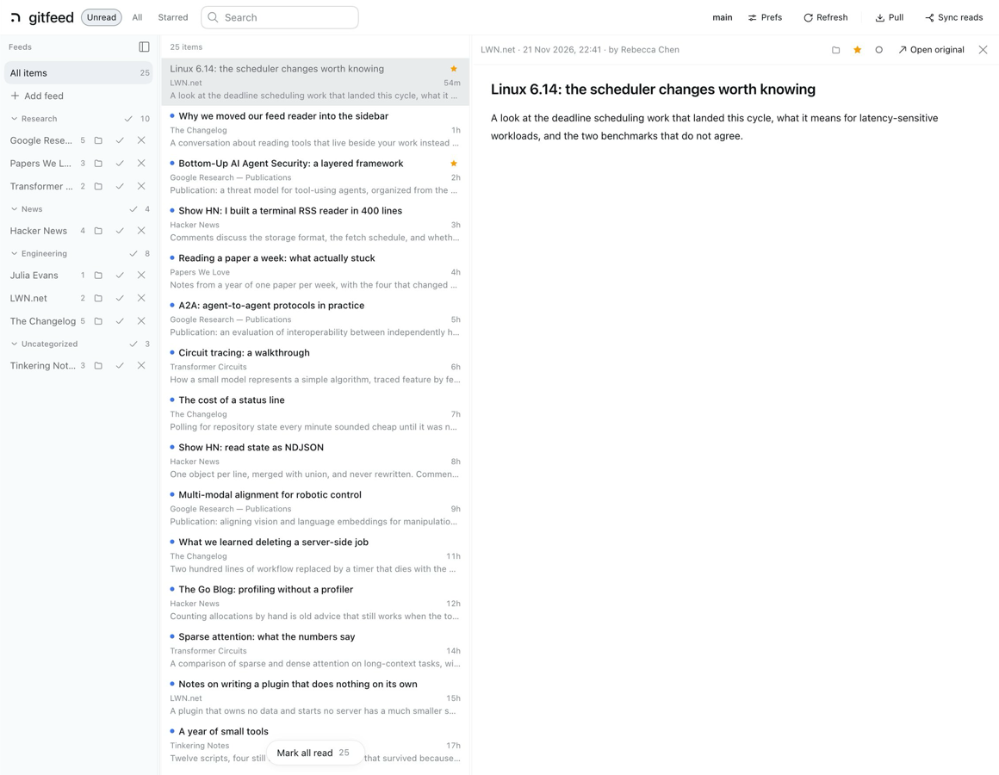
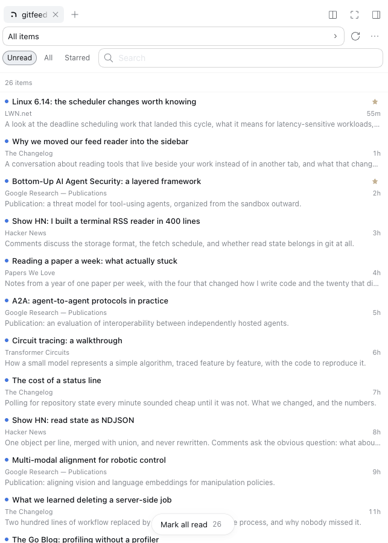
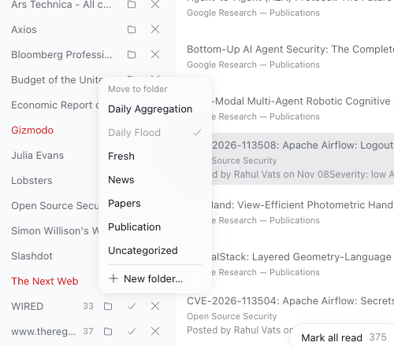

# gitfeed-native

A personal RSS reader rendered as a **native DeepSeek Harness plugin**: a reader
page in the right Sidebar (beside Files) and in the main panel, a Host-side
job runner for feed refresh and read-state sync, and one compact
`gitfeed` agent tool.

The package is **code only**. The data it reads lives in a separate repository,
so installing, updating, and sharing the plugin never touches subscriptions,
items, or read state — it writes nothing into that repository and asks for no
token. Fetching happens where the reader runs, on the Host's own job runner;
there is no server-side job to arm. The reference notes are in
[`docs/`](docs/), listed under [Documentation](#documentation).

## What it looks like

The panel: folders on the left, one line per item with its digest, and the
article beside them. The folder list is a panel of the page, not the page
itself: the panel toggle in its own header folds it, the rows and the article
take the width it gives up, and folded it leaves a 32px spine with the same
toggle at the top — the shape the app's own sidebar uses, one level down. The
fold eases on the app's own curve: the list keeps the width it was laid out at
while the pane clips it and fades it out, the spine arrives when that fade is
done, and the way back fades the list in as the pane opens. A feed row carries
its own actions — move it to a folder, mark the source read, unsubscribe — and
the star sits on the item row, so keeping something does not mean opening it
first.



The same reader in the right Sidebar, beside whatever session is open:



Moving a source lists the folders already in use, marks the one it is in, and
keeps naming a new one on its own row:



The library in those images is a fixture (`docs/screenshots/demo-library.js`),
not a real reading list: it answers the reader's own API with invented
subscriptions and items, so no one's feeds or history are in this repository.

## Two repositories, one reader

| repository | contents | visibility |
| --- | --- | --- |
| `zizon/gitfeed-native` (this one) | the plugin: TypeScript sources, bundle metadata, CLI | public |
| your data repository, or the root the plugin scaffolds | the reader data: `feeds.json`, `config.json`, `data/` | yours — private, or not a repository at all |

Why split them:

- **The code can be public, the reading cannot.** Installing from GitHub means
  the plugin repository is readable by anyone. Subscriptions, fetched items,
  and read/star ids belong to the person reading them, so they stay in a
  repository that person owns. The data repository can stay private forever.
- **Updates stop colliding with data commits.** `git pull` for code and
  `git pull` for read state are now different repositories, so a plugin upgrade
  can never rebase your reading list.
- **The data is portable.** The plugin's default `repo` is `~/gitfeed`; a clone
  of your data repository there — or a root the plugin scaffolds — is the whole
  setup. Nothing about the plugin pins a machine or a user.

The plugin is developed against a working library, and the CLI in this package
runs the same `lib/host` fetcher the reader uses.

## Quick start

1. Nothing to clone: the first activation creates `~/gitfeed` — a git
   repository on `main` holding an empty inbox and the config defaults.
2. Install the bundle (see **Install**).
3. Open the **Feeds** card, subscribe, **Refresh**, read. To back the root up,
   add a git remote and press **Sync reads** (see **Where backups land**).

Each item row shows the title, its feed and age, and a one-line plain-text
digest of the summary, so a list can be skimmed and skipped without opening
every article. Display prefs turn the digest off (rows then use the shorter
two-line height); the choice is stored per browser. An item whose feed gave no
summary keeps its digest line empty rather than dropping it: the row is a fixed
grid and the star sits on the title's line, so a missing summary must not move
the star, the title, or the ages on the rows around it.

Both actions a reader wants *while reading a feed* live on that feed's section
row in the list: `Open Source Security  [Unsubscribe] [Mark 16 read]`. The
section header sticks to the top while its section is in view, so they are at
hand whenever a post from that feed is on screen; `Unsubscribe` first swaps the
row into a confirm (`Cancel` / `Unsubscribe`) and only then removes the
subscription and that feed's items. A folder section can only be marked.
The Feeds panel keeps the same two marks on a feed's own row, which is how a
feed is managed without opening it, and no row shows a count twice.

A single selected source is marked from its own row, so the floating bar speaks
only for a wider view: an active search (`Mark results read`) or the whole
library (`Mark all read`). Its ▾ appears only when the other of those two
exists, and the library-wide entry needs a second, differently placed click.
The toast that follows carries **Undo**. No key marks in bulk.

Background refresh: the rail's second bar ends with the age of the last run
(`2m`; it shows `…` while a run is in flight and the Refresh button spins then).
The ⋯ menu's **Refresh** block shows the interval and the last result
(`0 new · 35 failed`), and its **Read state** block carries the two manual
actions and the auto-sync interval, the next run, and the last result. The main
page's status line carries the refresh interval beside the branch, with the
same detail in its tooltip.

## Where it lives in the Harness UI

| surface | how to reach it |
| --- | --- |
| Right Sidebar page | the RSS button in the conversation header, or the **Feeds** card in the right Sidebar's **+** guide. It sits beside Files, Documents, Terminals, and Plans. |
| Main panel page | the gitfeed icon in the left Sidebar's global panel rail (beside Plugins and Tasks). This view also works without a session. |
| Agent tool | `gitfeed` in the Tool catalog. |

All surfaces share one client controller and one Host API, so read state and the
selected article stay consistent if both are open.

The main panel is the three-pane layout. The right Sidebar page is a single
pane until its tab is wide (680px or more, for example in fullscreen), where it
splits into list and article: drag the divider between them to resize, and
double-click it to reset. The width is stored with the main page's list width.

## Install

The package needs Node 24.9 or newer — the floor the Harness runs on, and the
one `engines` declares.

Harness installs the bundle the same way it installs any external plugin:
`plugin_manager` with a package spec, or **Plugins → Add source** in the Web UI.
Two forms work.

**From the npm registry**, which is the normal install:

```json
{ "action": "install_bundle", "target": "@zizon/gitfeed-native" }
```

The manager reads the published version list, so an update is a version bump in
the same panel. Nothing is built in the profile: the tarball already carries
`lib/`, so there are no `devDependencies` to install and no build script to
approve.

**From Git**, for a checkout or a commit that is not on the registry yet:

```json
{ "action": "install_bundle", "target": "git+ssh://git@github.com/zizon/gitfeed-native.git" }
```

pnpm clones the package into the profile, installs its `devDependencies`, and
runs `prepare` (`node build.mjs`), so the installed copy carries `lib/`,
`bin/`, and the bundle metadata; the profile records a git dependency pinned to
the installed commit. pnpm blocks dependency build scripts by default, so the
first attempt stops with the package under `pendingBuilds`: approve that
`@zizon/gitfeed-native@<url>#<commit>` key (**Allow these scripts and retry** under
Plugins, or `approvedBuilds` on the tool's retry) and the installation
finishes. A registry install skips this step entirely.

`github:zizon/gitfeed-native` is the shorter address when no SSH key is set up.

### Data root

The plugin reads and writes one directory — the data root — resolved as:

1. `repo` in the Host row's `config:`,
2. `$GITFEED_REPO`,
3. `~/gitfeed`.

That directory holds `feeds.json`, `config.json`, `data/`, and the gitignored
`.local/` refresh cache. Normally it is a clone of your data repository; when
it is missing or empty, the first activation writes a starter version so the
reader mounts with an empty inbox instead of an error, and runs
`git init -b main` on it, so the root is a repository from the first run:

```
feeds.json             {"feeds": []}
config.json            fetch/reader defaults
data/meta.json         {}
data/read.ndjson       (empty)
data/starred.ndjson    (empty)
data/interest.ndjson   (empty — the attention log; see "The order of the sources")
.gitattributes         union-merge rules for read/starred/interest/item lines
.gitignore             .local/ and friends
```

A root seeded this way has no remote, so backing it up is one step: point it at
a repository you own. The CLI's `gitfeed init <dir>` writes the same starter
for a root other than `~/gitfeed`.

### Where backups land

- **The scaffolded root** is a repository on `main` with no remote. Everything
  works — subscribe, fetch, read, star — and `Pull` and `Sync reads` say there is
  nowhere to push to until one exists.
- **A root with an `origin`**: `Pull` fetches items and read state from the
  remote; `Sync reads` commits `feeds.json`, `config.json`, `data/items/`,
  `data/read.ndjson`, `data/starred.ndjson`, `data/interest.ndjson`,
  `.gitattributes`, and `.gitignore`, rebases, and pushes. The first one
  commits the whole seeded tree as the baseline and pushes with
  `-u origin HEAD` when no upstream exists yet.
- **A directory with no repository at all** still reads; create one when you
  want the state backed up or shared.

To start backing up, create an empty **private** repository on GitHub, then:

```bash
cd ~/gitfeed
git remote add origin git@github.com:<you>/gitfeed-data.git
```

Press **Sync reads** in the reader — the first run commits the starter tree and
pushes it. To join an existing data repository, `git clone` it to `~/gitfeed`
instead; anything with an `origin` takes the same path. Then set `repo` in the
profile patch if the path is not `~/gitfeed`.

### Updating

A **registry** install updates in place: `install_bundle` with the same package
name and the newer version, or the update entry the manager offers once a newer
version is published. Nothing in the profile is rebuilt.

A **Git** install is replaced: `plugin_manager remove_bundle` with
`@zizon/gitfeed-native`, then `install_bundle` with the same address (in the Web UI,
remove the source and add it again). The new commit rebuilds through the same
`prepare` script, and the approval key follows the new commit.

Either way the data root is untouched.

### Harness compatibility

The plugin runs inside the user's Harness, and the two move separately. Where
the plugin has to ask the Harness a question at request time, it asks what the
running generation actually offers instead of assuming one release's shape:

- **Stream admission.** Before Harness 0.2.2, a route admitted its own request
  through Connection's `requestRejection`; from 0.2.2 the web server
  authenticates every route before dispatch and Connection no longer carries
  the method. The stream route calls the check when it exists and falls back to
  its own origin fence otherwise ([events.ts](src/host/events.ts),
  `streamAdmission`), so a Host restart on either generation serves the reader.
  Calling the removed method made every stream request fail before its first
  byte, which the page could only show as a reader with no state.
- **The Connection service is looked up per request**, not captured at load, so
  a profile that loads it after this plugin still gets the check applied.

A Harness upgrade is picked up by the next `dsh web` restart; a plugin update
needs only a page reload unless its Host half changed.

## Reading

A tour; the full description, the list's model, the source order, and the design
language are in [`docs/reading.md`](docs/reading.md).

- **Filters**: Unread / All / Starred, with search over title, summary, and feed
  title answered by the Host.
- **Sources**: folders from the OPML import, collapsible, with unread counts and
  error marks. Every feed row carries its actions in view — move to a folder,
  mark the source read, unsubscribe — and the source list folds to a 32px spine
  from the panel toggle in its own header.
- **List**: one row per item — title, feed and age, one-line digest — grouped by
  folder or source on request. The section header sticks while its section is in
  view and carries that section's marks.
- **Nothing moves under the pointer**: a row that was read stays listed, arrivals
  from a refresh are held back while a list is on screen, and a rebuild puts the
  list back on the row that was under its top edge.
- **Reading**: sanitized feed HTML, star and mark-unread on the article, a
  **Next →** control past the opening, and `j`/`k`/`m`/`s`/`o`/`/`/`Esc` on the
  keyboard.
- **Top bar**: **Refresh** fetches every feed now; **Pull** and **Sync reads**
  move the git-backed archive and say why they are off when the root is a local
  copy or `allowGit` is false.
- **Preferences**: hide empty feeds, read-on-scroll, grouping, the source order,
  and the folded rail are per browser in one `gitfeed.prefs` snapshot; the
  values in `config.json` are the defaults.

## Fetching and syncing

The Host plugin runs two jobs on its own timer service, so there is no
server-side job, no workflow to keep in sync, and no token to hand to CI.

- **Refresh** refills the gitignored `.local/` cache every `refreshMinutes` (5)
  while the reader is active — a request in the last `idleMinutes` (15). Each
  feed keeps its own clock: one that produces items stays on the base interval,
  a quiet one doubles up to `maxIntervalMinutes` (a day), and a failure moves
  only its next attempt. A run where every attempted feed was unreachable is
  the network, not the subscriptions, and judges no feed.
- **Sync** commits and pushes read state about twenty seconds after the last
  change, pulls when the reader is quiet, backs off to `syncMaxMinutes` (60),
  and needs `allowGit` plus a working tree with an `origin`.
- **Refresh** in the reader still fetches everything. The cadences in full, the
  CLI (`gitfeed fetch`, `import-opml`, `init`), and the cron entry for an
  always-on machine are in [`docs/fetching.md`](docs/fetching.md); the runner
  contract is [`docs/jobs.md`](docs/jobs.md).

## Configuration

Data-root files: `feeds.json` is *what* you read, `config.json` is *how* the
fetcher and reader behave. The plugin's own schedule/git/tool switches live in
the plugin config, so they survive upgrades.

`feeds.json`:

```json
{
  "feeds": [
    { "id": "hn", "url": "https://news.ycombinator.com/rss" },
    { "id": "blog", "url": "https://example.com/feed.xml", "title": "Example", "folder": "News" },
    { "id": "noisy", "url": "https://example.com/rss", "disabled": true }
  ]
}
```

`config.json`:

| key | default | effect |
| --- | --- | --- |
| `fetch.concurrency` | 6 | feeds fetched in parallel |
| `fetch.timeoutMs` | 25000 | per-feed HTTP timeout |
| `fetch.keepMonths` | 6 | item shards older than this are deleted |
| `fetch.maxSummaryChars` | 0 | HTML kept per item; 0 keeps the feed's body whole |
| `reader.hideEmptyFeeds` | true | initial state of "hide 0-unread" |
| `reader.markReadOnScroll` | true | initial state of "read on scroll" |
| `reader.groupBy` | none | initial grouping: none / folder / feed |

Plugin config (the Host row's `config:` in the profile patch):

The shipped defaults are declared in the bundle's `cordis.patch.yml`, so that
file doubles as the reference for every setting. A profile patch that targets
the `gitfeed` row replaces `config` wholesale (the Loader never deep-merges it),
so an override restates every key it should keep.

| key | default | effect |
| --- | --- | --- |
| `repo` | `$GITFEED_REPO` or `~/gitfeed` | data root (a checkout of the data repository or a starter copy) |
| `refreshMinutes` | 5 | minimum interval between refresh runs, and the interval a feed that keeps producing items gets; 0 disables the schedule |
| `idleMinutes` | 15 | stop scheduled refreshes after this long without a request |
| `adaptive` | true | per-feed intervals: quiet or failing feeds back off |
| `maxIntervalMinutes` | 1440 | ceiling of that backoff |
| `syncMinutes` | 10 | minutes between read-state syncs; marks push after a ~20 s debounce and a quiet reader backs off to `syncMaxMinutes`; 0 disables auto-sync |
| `syncMaxMinutes` | 60 | ceiling of the sync backoff |
| `allowGit` | true | expose Pull and Sync, enable auto-sync, and show the git status line |
| `tool` | true | register the `gitfeed` and `gitfeed_custom_feed` agent tools |
| `skill` | true | register the `custom-feeds` skill |
| `brief` | true | put the five-line brief in every session's system prompt |

Precedence: **environment variable > `config.json` > built-in default** for
fetch/reader values; **environment variable > plugin config > built-in default**
for `refreshMinutes`, `adaptive`, `maxIntervalMinutes`, `syncMinutes`,
`syncMaxMinutes` and `allowGit`.

| env | overrides |
| --- | --- |
| `GITFEED_REPO` | plugin `repo` |
| `GITFEED_CONCURRENCY` | `fetch.concurrency` |
| `GITFEED_TIMEOUT_MS` | `fetch.timeoutMs` |
| `GITFEED_KEEP_MONTHS` | `fetch.keepMonths` |
| `GITFEED_LOCAL_FETCH_MIN` | plugin `refreshMinutes` (`0` disables) |
| `GITFEED_FETCH_ADAPTIVE` | plugin `adaptive` (`0` fetches every feed per run) |
| `GITFEED_FETCH_MAX_MIN` | plugin `maxIntervalMinutes` |
| `GITFEED_SYNC_MIN` | plugin `syncMinutes` (`0` disables auto-sync) |
| `GITFEED_SYNC_MAX_MIN` | plugin `syncMaxMinutes` |
| `GITFEED_ALLOW_GIT` | plugin `allowGit` (`0` disables) |

## Agent tools

Two tools, split by intent: `gitfeed` reads and manages the reader,
`gitfeed_custom_feed` authors a feed for a page that has none. The
`custom-feeds` skill walks an agent through the second.

Every session in the profile also carries a five-line **brief** the plugin puts
in its system prompt: the data root, `data/` versus `.local/`, what needs a
restart, and a path to this file. A README is a file — installing a package
never shows it to an agent — so the invariants an agent needs before it asks
belong in the prompt, and the rest is loaded when a task matches a skill.

`gitfeed`:

| action | parameters | result |
| --- | --- | --- |
| `status` | — | repo, version, feed/item/unread counts, the folder names in use, git and job state |
| `list` | `query`, `feed`, `unreadOnly`, `starredOnly`, `limit` | compact item rows with a short excerpt |
| `get` | `id` | one item's plain-text summary (up to 12k chars) |
| `mark` | `ids`, `read` | changed count |
| `star` | `ids`, `starred` | changed count |
| `refresh` | — | fetcher summary |
| `subscribe` | `url`, `folder` | new feed entry |
| `unsubscribe` | `id` | removed feed id |
| `folder` | `id`, `folder` | the feed entry as written; an empty folder means Uncategorized |
| `pull` / `sync` | — | git result; a local copy reports that it is not a working tree |

`gitfeed_custom_feed`:

| action | parameters | result |
| --- | --- | --- |
| `list` | — | declared custom feeds, each with its item count and last error |
| `scaffold` | `name` | writes `sources/<name>.mjs` from a commented skeleton |
| `check` | `script`, `url`, `options` | runs the script and reports the item count, how many carried a date, and five sample rows; writes nothing |
| `subscribe` | `script`, `url`, `title`, `folder`, `options` | the new feed entry, fetched immediately |

The loop is `scaffold` → edit → `check` → `subscribe`. `check` runs a script the
way the fetcher would, with the same deadline, so a script that is wrong is one
tool call away from its own error message instead of a red row. The
`custom-feeds` skill carries the interface, the rules, and the failure modes;
the plugin registers it unless the row sets `skill: false`.

All of these call the same Host methods the reader uses.

## Data format

Items are append-only NDJSON shards under `data/items/YYYY-MM.ndjson`, with
`data/meta.json` holding each feed's ETag, Last-Modified, and last error. Read
and star state, and the attention log behind the source order, are append-only
id sets. A fetch writes only the gitignored `.local/` cache.

```json
{"id":"b77b13687363294f","feed":"simonwillison","title":"Quoting Kyle Kingsbury","link":"https://simonwillison.net/2026/Nov/1/kyle-kingsbury/","date":"2026-11-01T16:49:04.000Z","author":"","summary":"<blockquote>..."}
```

`id` is `sha1(feedId + "|" + guid-or-link)` truncated to 16 hex characters, so a
re-published entry is never imported twice. The two item stores, the merge
rules, and the `merge=union` attributes are in
[`docs/data-format.md`](docs/data-format.md).

A subscription with no feed behind it may name a script: the declaration, the
interface, and a worked example are in
[`docs/custom-feeds.md`](docs/custom-feeds.md).

## Documentation

| note | covers |
| --- | --- |
| [`docs/reading.md`](docs/reading.md) | the page, the list's visible-window model, the source order, the design language |
| [`docs/state-stream.md`](docs/state-stream.md) | the event stream: deltas, revisions, digests, measured cost |
| [`docs/fetching.md`](docs/fetching.md) | the two adaptive jobs, the CLI, cron |
| [`docs/data-format.md`](docs/data-format.md) | item shards, the two stores, merge rules |
| [`docs/custom-feeds.md`](docs/custom-feeds.md) | a script-backed subscription: interface, rules, example |
| [`docs/engineering.md`](docs/engineering.md) | bundle registration, layout, build, gates, release |
| [`docs/jobs.md`](docs/jobs.md) | the runner contract, primitives, ratchet |
| [`docs/list-state.md`](docs/list-state.md) | the item list's state machine (review, 2026-11-13) |
| [`docs/async-api.md`](docs/async-api.md) | the async boundaries, surface by surface (review, 2026-11-09) |
| [`docs/ui-audit.md`](docs/ui-audit.md) | the client surfaces against the app's design rules (2026-11-09) |
| [`docs/history/`](docs/history/) | point-in-time records: the removed Actions job, cloud sync |

The published package contains `lib/`, `bin/`, `cordis.patch.yml`, `locale/`,
`icon.svg`, `docs/screenshots/`, and this README; the notes above are
repository documentation.

## Limitations

- **Only what the feed gives you.** Some feeds publish a teaser; "Open
  original" is one click away.
- **Not offline.** Images are hotlinked from the origin.
- **Fetching needs a fetcher somewhere.** The Host does it while it runs, and a
  cron entry on an always-on machine covers the rest. If nothing is running,
  items wait; a machine that sleeps fetches again on its next wake-up, and a
  connection that comes back is retried within one base interval (5m by
  default), not on the ladder the outage would have built.
- **Loopback only.** The API is served by the Harness web server and refuses
  cross-origin requests; it is not designed to be exposed publicly.
- **The reader needs its Host's event stream.** There is no polling fallback: a
  page refreshed before a Host restart cannot load, and a proxy that buffers
  `text/event-stream` breaks it. Update and restart together.
- **The right Sidebar needs a session.** The main-panel page works without one.
- **Item history is pruned** to `fetch.keepMonths` (6) to keep the data repo
  small. The attention log is not pruned: it accrues one short row per opened or
  starred article, and only its last couple of months move the order.
- **The source order is a habit, not a setting per row.** It is learned from
  opened and starred rows only: a reader who reads the digests and never opens an
  article gives it nothing to learn from, and the rail stays alphabetical. There
  is no per-source pin; the switch turns the whole order off.
- **Feed health is manual.** Dead feeds show red in the rail and in
  `data/meta.json`; nothing emails you. An unreachable *network* is not a dead
  feed: those runs judge no source and only the status line reports them.
- **The installed copy is a build artifact.** Editing the profile's
  `node_modules/gitfeed-native` is overwritten by the next install; edit this
  checkout and reinstall.
- **The data repository is yours to back up.** Nothing in this package stores
  or uploads the data; a lost data checkout is a lost reading list.

## License

MIT — see [LICENSE](LICENSE).
