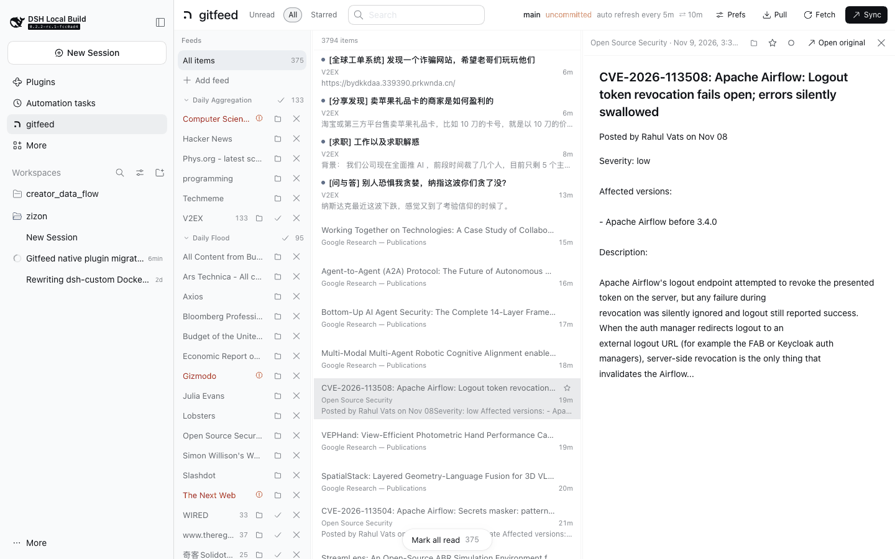
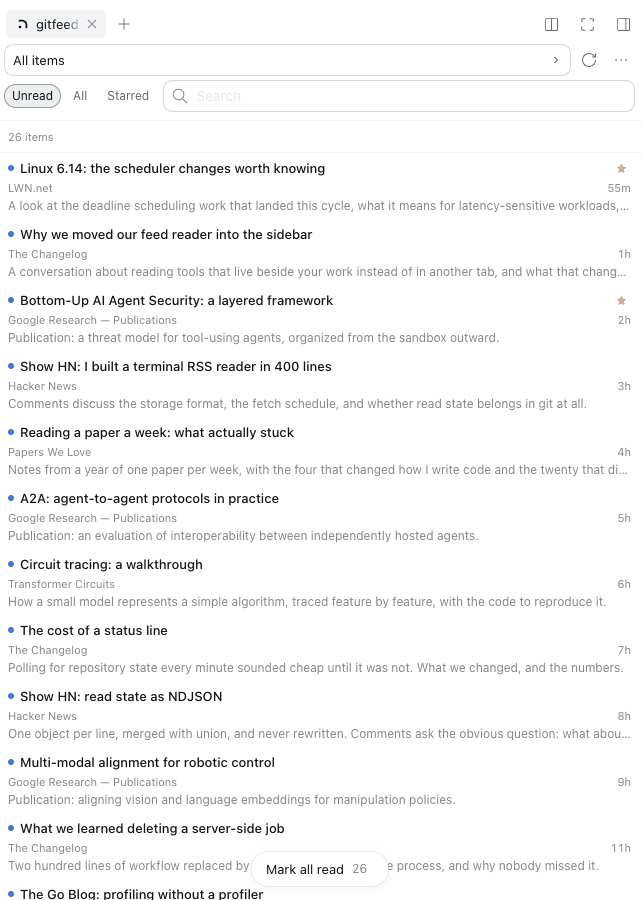
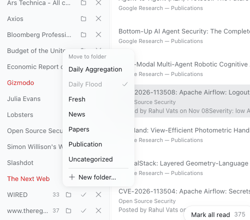

# gitfeed-native

A personal RSS reader rendered as a **native DeepSeek Harness plugin**: a reader
page in the right Sidebar (beside Files) and in the main panel, a Host-side
job runner for feed refresh and read-state sync, and one compact
`gitfeed` agent tool.

The package is **code only**. The data it reads lives in a separate repository,
so installing, updating, and sharing the plugin never touches subscriptions,
items, or read state — it writes nothing into that repository and asks for no
token. Fetching happens where the reader runs, on the Host's own job runner;
there is no server-side job to arm.

## What it looks like

The panel: folders on the left, one line per item with its digest, and the
article beside them. A feed row carries its own actions — move it to a folder,
mark the source read, unsubscribe — and the star sits on the item row, so
keeping something does not mean opening it first.



The same reader in the right Sidebar, beside whatever session is open:



Moving a source lists the folders already in use, marks the one it is in, and
keeps naming a new one on its own row:



The library in those images is a fixture (`docs/screenshots/demo-library.js`),
not a real reading list: it answers the reader's own API with invented
subscriptions and items, so no one's feeds or history are in this repository.

## Two repositories, one reader

| repository | contents | visibility |
| --- | --- | --- |
| `zizon/gitfeed-native` (this one) | the plugin: TypeScript sources, bundle metadata, CLI | public |
| `zizon/gitfeed` | the reader data: `feeds.json`, `config.json`, `data/` | private, cloned to `~/gitfeed` |

Why split them:

- **The code can be public, the reading cannot.** Installing from GitHub means
  the plugin repository is readable by anyone. Subscriptions, fetched items,
  and read/star ids belong to the person reading them, so they stay in a
  repository that person owns. The data repository can stay private forever.
- **Updates stop colliding with data commits.** `git pull` for code and
  `git pull` for read state are now different repositories, so a plugin upgrade
  can never rebase your reading list.
- **The data is portable.** The plugin's default `repo` is `~/gitfeed`; cloning
  your data repository there is the whole setup. Nothing about the plugin pins
  a machine or a user.

The plugin still dogfoods: this checkout is developed against the real data
repository, and the CLI in this package runs the same `lib/host` fetcher the
reader uses.

## Quick start

1. Clone the data repository to `~/gitfeed` (or let the plugin write a starter
   root on first activation).
2. Install the bundle (see **Install**).
3. Open the **Feeds** card, subscribe, **Fetch**, read. If the root is a
   checkout, **Sync** pushes subscriptions and read state.

Each item row shows the title, its feed and age, and a one-line plain-text
digest of the summary, so a list can be skimmed and skipped without opening
every article. Display prefs turn the digest off (rows then use the shorter
two-line height); the choice is stored per browser.

Both actions a reader wants *while reading a feed* live on that feed's section
row in the list: `Open Source Security  [Unsubscribe] [Mark 16 read]`. The
section header sticks to the top while its section is in view, so they are at
hand whenever a post from that feed is on screen; `Unsubscribe` first swaps the
row into a confirm (`Cancel` / `Unsubscribe`) and only then removes the
subscription and that feed's items. A folder section can only be marked.
The Feeds panel keeps the same two marks on a feed's own row, which is how a
feed is managed without opening it, and no row shows a count twice.

A single selected source is marked from its own row, so the floating bar speaks
only for a wider view: an active search (`Mark results read`) or the whole
library (`Mark all read`). Its ▾ appears only when the other of those two
exists, and the library-wide entry needs a second, differently placed click.
The toast that follows carries **Undo**. No key marks in bulk.

Background refresh: the rail's second bar ends with the age of the last run
(`2m`; it shows `…` while a run is in flight and the Fetch button spins then).
The ⋯ menu's **Refresh** block shows the interval and the last result
(`0 new · 35 failed`), and its **Sync** block shows the auto-sync interval,
the next run, and the last result. The main page's status line carries the
refresh interval beside the branch, with the same detail in its tooltip.

## Where it lives in the Harness UI

| surface | how to reach it |
| --- | --- |
| Right Sidebar page | the RSS button in the conversation header, or the **Feeds** card in the right Sidebar's **+** guide. It sits beside Files, Documents, Terminals, and Plans. |
| Main panel page | the gitfeed icon in the left Sidebar's global panel rail (beside Plugins and Tasks). This view also works without a session. |
| Agent tool | `gitfeed` in the Tool catalog. |

All surfaces share one client controller and one Host API, so read state and the
selected article stay consistent if both are open.

The main panel is the three-pane layout. The right Sidebar page is a single
pane until its tab is wide (680px or more, for example in fullscreen), where it
splits into list and article: drag the divider between them to resize, and
double-click it to reset. The width is stored with the main page's list width.

## Bundle registration

| surface | registration |
| --- | --- |
| right Sidebar page | `sidebarRightTabs` type `gitfeed` + `sidebar.right.pane.tab` body and title |
| right Sidebar guide | one **Feeds** card in the guide |
| session-header launcher | `conversation.session.header.utilities` |
| main panel | `main` key `gitfeed` + `sidebar.panellist` icon |
| agent tool | `ctx.tools.register({ name: 'gitfeed', ... })` |

The API route is registered with `ctx.effect` and the scheduler takes its
timers from `ctx.timeout`, so both disappear when the row unloads. `mark`/`star` responses carry the new state version, which
lets the Client poll compactly after an optimistic update.

## Install

The package needs Node 24.9 or newer — the floor the Harness runs on, and the
one `engines` declares.

Harness installs the bundle the same way it installs any external plugin:
`plugin_manager` with a package spec, or **Plugins → Add source** in the Web UI.
Two forms work.

**From the npm registry** (preferred once a version is published):

```json
{ "action": "install_bundle", "target": "@zizon/gitfeed-native" }
```

The manager reads the published version list, so an update is a version bump in
the same panel. Nothing is built in the profile: the tarball already carries
`lib/`, so there are no `devDependencies` to install and no build script to
approve.

**From Git**, which is the only form while this repository is private:

```json
{ "action": "install_bundle", "target": "git+ssh://git@github.com/zizon/gitfeed-native.git" }
```

pnpm clones the package into the profile, installs its `devDependencies`, and
runs `prepare` (`node build.mjs`), so the installed copy carries `lib/`,
`bin/`, and the bundle metadata; the profile records a git dependency pinned to
the installed commit. pnpm blocks dependency build scripts by default, so the
first attempt stops with the package under `pendingBuilds`: approve that
`@zizon/gitfeed-native@<url>#<commit>` key (**Allow these scripts and retry** under
Plugins, or `approvedBuilds` on the tool's retry) and the installation
finishes. A registry install skips this step entirely.

After the repository is public, `github:zizon/gitfeed-native` (HTTPS, no key)
works too.

### Data root

The plugin reads and writes one directory — the data root — resolved as:

1. `repo` in the Host row's `config:`,
2. `$GITFEED_REPO`,
3. `~/gitfeed`.

That directory holds `feeds.json`, `config.json`, `data/`, and the gitignored
`.local/` refresh cache. It is a clone of the data repository (or any checkout
of it). When it is missing or empty, the first
activation writes a starter version so the reader mounts with an empty inbox
instead of an error:

```
feeds.json             {"feeds": []}
config.json            fetch/reader defaults
data/meta.json         {}
data/read.ndjson       (empty)
data/starred.ndjson    (empty)
.gitattributes         union-merge rules for read/starred/item lines
.gitignore             .local/ and friends
```

### A local copy vs a checkout

- **No git repository** (the starter root): everything works — subscribe, fetch,
  read, star — but `Pull` and `Sync` are disabled, because there is nothing to
  push to.
- **A git checkout** with an `origin`: `Pull` fetches items and read state from
  the remote; `Sync` commits `feeds.json`, `config.json`, `data/items/`,
  `data/read.ndjson`, `data/starred.ndjson`, `.gitattributes`, and
  `.gitignore`, rebases, and pushes. The very first `Sync` of a freshly `git init`-ed directory commits the
  whole tree as the baseline and pushes with `-u origin HEAD` when no upstream
  exists yet.

To sync, create (or clone) your own data repository and point the plugin at it:

```bash
# a new private repository, seeded by the plugin
node ~/gitfeed-native/bin/gitfeed.mjs init ~/gitfeed   # from a code checkout
cd ~/gitfeed && git init -b main && git add -A \
  && git commit -m "gitfeed: starter data" \
  && git remote add origin git@github.com:<you>/gitfeed-data.git \
  && git push -u origin main

# or an existing data repository
git clone git@github.com:<you>/gitfeed-data.git ~/gitfeed
```

Once published, the same `init` is `npx --yes --package=github:zizon/gitfeed-native gitfeed init ~/gitfeed`.

Then set `repo` in the profile patch if the path is not `~/gitfeed`.

### Updating

A **registry** install updates in place: `install_bundle` with the same package
name and the newer version, or the update entry the manager offers once a newer
version is published. Nothing in the profile is rebuilt.

A **Git** install is replaced: `plugin_manager remove_bundle` with
`@zizon/gitfeed-native`, then `install_bundle` with the same address (in the Web UI,
remove the source and add it again). The new commit rebuilds through the same
`prepare` script, and the approval key follows the new commit.

Either way the data root is untouched.

## Fetching and syncing

### Adaptive jobs

The Host plugin owns one job runner for every periodic thing the reader does.
Each job owns its cadence: a run that produced something (items fetched, state
committed or pulled) returns to the base interval, while a quiet or failing run
doubles it, up to the ceiling — per feed for Refresh, one interval for Sync.
The runner stores what the job reports (`nextAt`, `intervalMin`), arms that
job's own timer, and renders the status line; it has no backoff policy of its
own.

Two jobs are registered today. A new one implements `available`, `due`, and
`run` and is added next to them in `src/host/service.ts`.

**Refresh** refills the gitignored `.local/` cache:

- base interval `refreshMinutes` (default 5), ceiling `maxIntervalMinutes`
  (default 1440, once a day);
- only while the reader made a request in the last `idleMinutes` (default 15),
  so a forgotten panel does not hammer feeds overnight;
- each run fetches only the feeds whose own clock is due. A feed that keeps
  producing items stays on the base interval; a feed that answers 304,
  produces nothing, or fails doubles its interval on every quiet run, up to
  the ceiling, and drops back the moment it produces an item. That is what
  keeps a barely-updated blog from being polled every five minutes;
- never into the committed `data/` tree, so a refresh cannot race a commit.

**Sync** publishes and repairs read state:

- local marks, stars, and subscription changes start a short debounce, so a
  session's marks are committed, rebased, and pushed about twenty seconds
  after the last change; a burst of scroll marks coalesces into one commit;
- on a quiet machine it backs off to `syncMaxMinutes` (default 60) and only
  pulls, which is how a second device's marks arrive without pressing Pull;
- it waits `syncMinutes` (default 10) before its first run, so a plugin
  update does not push on its first second; that first run publishes any read
  state that was already waiting for a manual Sync; `syncMinutes: 0` disables
  auto-sync while Pull and Sync stay manual;
- it needs `allowGit`, a git working tree, and an `origin` remote; otherwise
  the job reports why it is off, using the repository facts the status line
  already caches rather than shelling out per tick.

Set `adaptive: false` to fetch every feed on every run. The job clocks and the
per-feed clocks live in `.local/schedule.json` — machine-local, never
committed, version 2; a version-1 file (the fetch-only format) is read as the
Refresh job's state. **Fetch** in the reader still fetches everything.

The cadence policy is the jobs'; the clock is the Harness's. The plugin
declares `inject: ['timer']` and takes each job's wake-up from `ctx.timeout`
(`@deepseek-ai/cordis-plugin-timer`, the mixin on the injected `timer` service,
which is what `src/index.ts` calls) on the plugin's fiber:
when a deadline moves, the old timer is disposed and a new one is armed, and a
reload or dispose cancels whatever is pending with the rest of the plugin. What
the timer service does not provide — per-feed backoff, the activity gate, the
stored burst deadline — lives with the job that needs it.

`ctx.timer.interval` is not used: the Refresh job's next run is the earliest
per-feed clock, not a period. `ctx.timer.debounce` is not used either: it lives
in memory, would be lost on reload, and cannot express the burst cap. The
debounce here is therefore a stored deadline (`nextAt`), evaluated by the same
pass as everything else. `ctx.schedule` (`@deepseek-ai/dsh-schedule`) is
durable and knows Cron and RRULE, but every occurrence it delivers becomes an
Agent turn in a Session, so using it would spend a model call per refresh.

The full contract and the primitive-by-primitive rationale are in
[`docs/jobs.md`](docs/jobs.md).

### No server-side job

Fetches run inside the Host, so there is nothing to deploy, no workflow to keep
in sync, and no token to hand to CI. The job runner refetches the feeds that are
due and the sync job pushes the result with whatever git credentials the
checkout already uses.

This package used to generate a GitHub Actions job for the data repository. It
was removed in 3.0.0 because GitHub never dispatched its schedule on this
account — with the evidence, the community reports behind it, and the restore
recipe in [`docs/history/cloud-sync.md`](docs/history/cloud-sync.md).

### CLI

The package ships the `gitfeed` command; it runs the same `lib/host` modules the
plugin uses:

```bash
gitfeed fetch                    # data root: --root, $GITFEED_REPO, else cwd
gitfeed fetch --only=jvns-ca-atom-xml
gitfeed fetch --dry-run
gitfeed fetch --refresh          # ignore cached ETags; re-read every feed
gitfeed import-opml ~/Downloads/feeds.opml
gitfeed import-opml --replace ~/Downloads/feeds.opml
gitfeed init ~/gitfeed           # write the starter data root
gitfeed --help
```

From a checkout without installing global bin:

```bash
node bin/gitfeed.mjs fetch --root ~/gitfeed
```

### Cron

The reader refreshes on its own while the Host runs. A machine that is always on
can additionally keep the committed `data/` tree current without the reader
open, by running the same fetcher from the installed CLI:

```bash
*/30 * * * * cd $HOME/gitfeed \
  && git pull --rebase --autostash -q \
  && node $HOME/gitfeed-native/bin/gitfeed.mjs fetch --root . \
  && git add data \
  && git commit -qm "feed: $(date -u +%FT%TZ)" \
  && git push || true
```

## Reading UI

The native page follows the Harness theme, including light/dark/auto. It does
not carry its own theme setting.

- **Filters**: Unread / All / Starred.
- **Search** over title, summary, and feed title, answered by the Host.
- **Feeds**: folders from the OPML import, collapsible; unread counts; error
  marks; one "Add feed" row that opens the form. Every feed row carries its
  actions in view — move it to another folder, mark the source read, and
  unsubscribe (colored destructive on hover, confirmed on click), which removes
  the subscription and that feed's items from both stores. That row is the only
  unsubscribe entry.
- **Moving a feed**: the folder control on a feed row opens a picker of the
  folders already in use — the current one is marked and cannot be picked
  again — so a move is one click and lands in a folder that exists.
  `New folder…` is its own row and swaps the feed's row for a field to name one.
  Nothing is re-fetched: the entry keeps its id, URL, title, and custom-feed
  declaration, so only the tree above it changes. The picker opens from three
  controls, one per place a source is in front of you: the feed row, the source
  section header next to `Unsubscribe` (the same grammar its other source
  actions use), and the article's action row — which is the only one reachable
  while reading in the Sidebar, where the list and its header sit behind the
  article.
- **List**: one line per item, grouped by folder or source on request. A
  section header sticks to the top while its section is in view and carries
  that section's actions — `Mark {n} read`, plus `Move` and `Unsubscribe` when
  the section is a source. Rows are virtualized at fixed heights.
  A row that is marked read stays in the Unread list while it is still under
  the pointer, so nothing shifts under it while reading; then it goes without
  the list moving: a grouped section fades where it stands and leaves once
  nothing in it is unread, and a flat list lets rows go in one batch as they
  scroll out of the mounted band. A feed or folder that was on screen stays in
  the Feeds list for the same reason.
- **Read on scroll**: a row counts as read only after the viewport top passed
  it while moving down; rows a scrollbar drag skipped over are included, and
  the screenful the scroll stops on counts as reached when the list ends.
- **Starring**: the star sits on the row itself, so an item can be kept without
  opening it; it holds its space and appears on the row the pointer or the
  keyboard is on, and a starred row shows it outright. Under the Starred filter
  the star *is* membership, so unstarring there drops the row at once.
- **Article**: sanitized feed HTML (element allowlist, `href`/`src`/`alt`/
  `title` only, http(s)/mailto URLs only), move its source to a folder, star,
  mark unread, open original.
  Past the opening of a piece a **Next →** control appears at the bottom of the
  pane, so moving on does not mean scrolling back up.
- **Pull / Fetch / Sync** in the top bar, drawn alike: Fetch reads the feeds,
  Pull takes the data root's commits from its remote, Sync commits the reader's
  marks and pushes them. Pull and Sync are disabled when the plugin `allowGit`
  switch is false, or when the data root is a local copy with no git
  repository; the rail menu then shows why.
- **Display preferences**: hide feeds with nothing unread, mark read on scroll,
  group by none/folder/source. Per-browser, in one `localStorage` snapshot
  (`gitfeed.prefs`) held by the shared store engine; the values in
  `config.json` are the defaults.
- **Keyboard**: `j`/`k` move, `m` toggle read, `s` star, `o` open original,
  `/` search, `u` unread, `a` all, `Esc` close article then clear search/feed.
  Bulk marking is deliberately not on a key.

Pane widths and open folders are remembered per browser.

### A list that does not move

A refresh lands while someone is reading, so the list is built to absorb one.
The Sidebar has one pane, so an open article is drawn over the list rather than
in place of it: the list stays mounted and closing an article returns to the
same rows at the same scroll position.

Three things follow from "nothing moves under the pointer". A row that has been
read stays listed until something else rebuilds the list, so the header counts
what the view **has** rather than what the list happens to hold: it is counted
from the archive, which is why it falls as the reading does instead of in jumps
when a rebuild finally releases those rows. A mark burst does not reload the
state behind it — the reader already holds the change it sent, and refetching
rebuilt the rows, the count, and the digest text under the pointer several
times a second while scrolling. And a refresh that lands while the reader is
scrolled into the archive holds its new rows back: the count says they are
there, the rows arrive when the reader leaves the spot they would have moved.

- **Sections hold one order.** Grouped sections are ordered by name — the way
  the rail lists folders and sources — instead of being re-ranked by item
  count. Ranking by size meant that every fetch, and every read mark under the
  Unread filter, could move the section being read somewhere else; a section
  that grows or shrinks now stays where it is.
- **The viewport is anchored to a row.** When rows are inserted above the
  viewport, the list is put back on the entry that was under its top edge, so
  the text being read does not slide down the screen. At the very top the new
  rows push in as expected instead.
- **Arrivals wait for the reader to move.** A fetch brings rows older than the
  newest ones on screen — feeds that were quiet for an hour deliver an hour's
  worth — so a new row lands *inside* the band being read, not only at its top,
  and inserting it pushes every row below it down. The fade meant to soften
  that read as the page blinking. Held rows are counted but not listed; they
  land when the reader returns to the top of the list, changes the scope, or
  asks for a refresh. Rows that arrive where the reader is *not* looking still
  fade in where they belong (`gf-row-in`), and a quiet poll changes nothing.
- **Ties are broken by id**, on the Host (`compareItems`), so two items that
  share a timestamp cannot swap places between reloads.

The stream is pulled. The route asks the Host for the next frame, writes it, and
only then asks for another, so a surface that is slow to read stops the producer
at the source instead of filling a queue in the request handler; what it falls
behind in is the revision cursor, and the kept history decides whether it is
caught up by a delta or by the whole state.

The wire carries a digest of a row: its body is cut to 400 characters and the
row says how long the real one is. The list only ever draws a 240-character
digest, and the text filter is answered by the Host, so nothing that needs the
full text travels with the list; an article that opens reads the one row it
shows, whole, over `/gitfeed/api/item`. The older `/state` route still answers
with whole bodies, because a page from before this change may still poll it.

The reader does not poll for its own state. Each surface opens one server-sent
event stream at `/gitfeed/events` when it mounts, receives the whole archive
once, and from then on only what changed: the rows a refresh added or repaired,
and the marks that moved. The Host keeps a live copy of what it last read, diffs
each new read against it, and sends the difference — a fetch that lands
seventeen rows ships seventeen rows, a mark ships two ids, and a quiet minute
ships nothing at all. A probe of the data root (twenty stats, well under a
tenth of a millisecond) runs every few seconds while a surface is attached, so a
fetch from the CLI, the agent tool, or a second Host reaches the reader too.

Revisions are the cursor. Every delta carries the next number; a surface that
reconnects asks from the last number it saw, and a gap the Host cannot explain
(it restarted, or the surface fell further behind than the history kept) is
answered with the whole state rather than a delta that would be wrong. Marks
travel the same way in the other direction, so a row read on one device leaves
the unread list on the other without either side asking.

The stream replaces a 60-second poll with a full model behind it. On a personal
library of 379 subscriptions and 3,860 items, an items write cost every open
surface 26.9 MB of JSON, and the poll itself cost the Host five `git` spawns
(190 ms) even when nothing had changed; a delta for the same write is about
100 KB, and an idle surface costs a stat probe every few seconds. The first
frame a surface receives is that model as digests — 25.7 MB before, 2.3 MB now
(0.84 MB compressed).

There is no second path. A surface that cannot open its stream — a page whose
client bundle is newer than the running Host, a proxy that buffers event
streams — says the Host cannot be reached and keeps trying, and the reader is
empty until it can. Restart the Host after updating the plugin, then reload the
page; that is the same restart a Host-side change needs anyway. The old `/state`
route stays on the Host because an older page may still be polling it, but this
client does not.

The text filter is answered by the Host, which holds every body whole: a query
travels as text and comes back as ids, and the surface keeps filtering by feed,
filter, and read state itself. That is what lets the wire carry a digest of a
row instead of its body — and what keeps a query matching text the list does not
have.

The first frame after a restart costs one read of the archive plus two git
commands, not five: branch, divergence, and dirty state come from one
`status --porcelain=v2 --branch`, started while the item model is being parsed
rather than after it. On that library the first frame arrives in about 0.23 s
instead of 0.38 s.

The archive is not re-read to answer questions the Host already can. The item
model keeps each shard's rows keyed by that shard's size and modification time,
so a fetch that appends to one month's file re-reads one file instead of
twenty-six megabytes; a fetch run takes the ids it already holds from that
model instead of scanning the stores, and leaves the orphan sweep to the
unsubscribe that already removed them. On the same library, one fetch run plus
the reader catching up went from about 0.9 s of Host CPU to about 0.08 s. The
git facts behind the status line are read on a change or every five minutes,
not on every run, because a refresh writes only the ignored local cache.

### Design language

The reader is built from the Harness client's own components, not a private
copy of them: the Client bundle requires
`@deepseek-ai/dsh-client-ui-primitives` from the shared module table and marks
it external, so the page gets the same buttons, inputs, menus, switches,
toasts, and icons the rest of the GUI renders, plus any theme change that
reaches them. The plugin ships no CSS for those controls.

- **Adopted**: `Button` for the toolbar and inline actions, `Pill` for the
  filter and group-by chips, `Input` for search and the add-feed form,
  `Menu` for the marking scope, `MenuSurface` for the preferences popover and
  the rail menu, `Switch` for the display prefs, `Toast` for transient
  banners with an inline **Undo**, and the product `Icon*` set for the
  chevrons, checks, close, refresh, plus, ellipsis, and open-original glyphs.
- **Kept custom, deliberately**: feed and item rows, the section header (sticky
  in flow, re-rendered as a pinned bar when its own row is above the mounted
  band), the float that follows the list's scroll edge, and the article's
  `Next →` capsule — the atom set has no list-row, group-header, or
  floating-bar primitive, so these are a small token-styled sheet rather than
  copies of a shared control. The RSS mark, the star, and the unread dot are
  artwork the theme does not carry.
- **Tokens**: hover and selected fills use
  `--dsw-alias-interactive-bg-*`, text uses `--dsw-alias-label-*`, hairline
  dividers are `0.5px` of `--dsw-alias-border-l*`, radii come from
  `--dsw-radius-*`, and floating surfaces use
  `--dsw-alias-button-floating-fill` with `--dsw-elevation-panel`. The blue
  accent is `--dsw-alias-brand-primary-new-colorprimary-new-color`;
  `--dsw-alias-brand-primary` is the near-black/near-white fill colour.

Toasts are the shared banner, so they appear centred at the top of the page
and carry one action; Undo is the action rather than a link in a stack.

## Configuration

Data-root files: `feeds.json` is *what* you read, `config.json` is *how* the
fetcher and reader behave. The plugin's own schedule/git/tool switches live in
the plugin config, so they survive upgrades.

`feeds.json`:

```json
{
  "feeds": [
    { "id": "hn", "url": "https://news.ycombinator.com/rss" },
    { "id": "blog", "url": "https://example.com/feed.xml", "title": "Example", "folder": "News" },
    { "id": "noisy", "url": "https://example.com/rss", "disabled": true }
  ]
}
```

`config.json`:

| key | default | effect |
| --- | --- | --- |
| `fetch.concurrency` | 6 | feeds fetched in parallel |
| `fetch.timeoutMs` | 25000 | per-feed HTTP timeout |
| `fetch.keepMonths` | 6 | item shards older than this are deleted |
| `fetch.maxSummaryChars` | 0 | HTML kept per item; 0 keeps the feed's body whole |
| `reader.hideEmptyFeeds` | true | initial state of "hide 0-unread" |
| `reader.markReadOnScroll` | true | initial state of "read on scroll" |
| `reader.groupBy` | none | initial grouping: none / folder / feed |

Plugin config (the Host row's `config:` in the profile patch):

The shipped defaults are declared in the bundle's `cordis.patch.yml`, so that
file doubles as the reference for every setting. A profile patch that targets
the `gitfeed` row replaces `config` wholesale (the Loader never deep-merges it),
so an override restates every key it should keep.

| key | default | effect |
| --- | --- | --- |
| `repo` | `$GITFEED_REPO` or `~/gitfeed` | data root (a checkout of the data repository or a starter copy) |
| `refreshMinutes` | 5 | minimum interval between refresh runs, and the interval a feed that keeps producing items gets; 0 disables the schedule |
| `idleMinutes` | 15 | stop scheduled refreshes after this long without a request |
| `adaptive` | true | per-feed intervals: quiet or failing feeds back off |
| `maxIntervalMinutes` | 1440 | ceiling of that backoff |
| `syncMinutes` | 10 | minutes between read-state syncs; marks push after a ~20 s debounce and a quiet reader backs off to `syncMaxMinutes`; 0 disables auto-sync |
| `syncMaxMinutes` | 60 | ceiling of the sync backoff |
| `allowGit` | true | expose Pull and Sync, enable auto-sync, and show the git status line |
| `tool` | true | register the `gitfeed` and `gitfeed_custom_feed` agent tools |
| `skill` | true | register the `custom-feeds` skill |
| `brief` | true | put the five-line brief in every session's system prompt |

Precedence: **environment variable > `config.json` > built-in default** for
fetch/reader values; **environment variable > plugin config > built-in default**
for `refreshMinutes`, `adaptive`, `maxIntervalMinutes`, `syncMinutes`,
`syncMaxMinutes` and `allowGit`.

| env | overrides |
| --- | --- |
| `GITFEED_REPO` | plugin `repo` |
| `GITFEED_CONCURRENCY` | `fetch.concurrency` |
| `GITFEED_TIMEOUT_MS` | `fetch.timeoutMs` |
| `GITFEED_KEEP_MONTHS` | `fetch.keepMonths` |
| `GITFEED_LOCAL_FETCH_MIN` | plugin `refreshMinutes` (`0` disables) |
| `GITFEED_FETCH_ADAPTIVE` | plugin `adaptive` (`0` fetches every feed per run) |
| `GITFEED_FETCH_MAX_MIN` | plugin `maxIntervalMinutes` |
| `GITFEED_SYNC_MIN` | plugin `syncMinutes` (`0` disables auto-sync) |
| `GITFEED_SYNC_MAX_MIN` | plugin `syncMaxMinutes` |
| `GITFEED_ALLOW_GIT` | plugin `allowGit` (`0` disables) |

## Agent tools

Two tools, split by intent: `gitfeed` reads and manages the reader,
`gitfeed_custom_feed` authors a feed for a page that has none. The
`custom-feeds` skill walks an agent through the second.

Every session in the profile also carries a five-line **brief** the plugin puts
in its system prompt: the data root, `data/` versus `.local/`, what needs a
restart, and a path to this file. A README is a file — installing a package
never shows it to an agent — so the invariants an agent needs before it asks
belong in the prompt, and the rest is loaded when a task matches a skill.

`gitfeed`:

| action | parameters | result |
| --- | --- | --- |
| `status` | — | repo, version, feed/item/unread counts, the folder names in use, git and job state |
| `list` | `query`, `feed`, `unreadOnly`, `starredOnly`, `limit` | compact item rows with a short excerpt |
| `get` | `id` | one item's plain-text summary (up to 12k chars) |
| `mark` | `ids`, `read` | changed count |
| `star` | `ids`, `starred` | changed count |
| `refresh` | — | fetcher summary |
| `subscribe` | `url`, `folder` | new feed entry |
| `unsubscribe` | `id` | removed feed id |
| `folder` | `id`, `folder` | the feed entry as written; an empty folder means Uncategorized |
| `pull` / `sync` | — | git result; a local copy reports that it is not a working tree |

`gitfeed_custom_feed`:

| action | parameters | result |
| --- | --- | --- |
| `list` | — | declared custom feeds, each with its item count and last error |
| `scaffold` | `name` | writes `sources/<name>.mjs` from a commented skeleton |
| `check` | `script`, `url`, `options` | runs the script and reports the item count, how many carried a date, and five sample rows; writes nothing |
| `subscribe` | `script`, `url`, `title`, `folder`, `options` | the new feed entry, fetched immediately |

The loop is `scaffold` → edit → `check` → `subscribe`. `check` runs a script the
way the fetcher would, with the same deadline, so a script that is wrong is one
tool call away from its own error message instead of a red row. The
`custom-feeds` skill carries the interface, the rules, and the failure modes;
the plugin registers it unless the row sets `skill: false`.

All of these call the same Host methods the reader uses.

## Data format

`data/items/2026-11.ndjson`, one item per line:

```json
{"id":"b77b13687363294f","feed":"simonwillison","title":"Quoting Kyle Kingsbury","link":"https://simonwillison.net/2026/Nov/1/kyle-kingsbury/","date":"2026-11-01T16:49:04.000Z","author":"","summary":"<blockquote>..."}
```

`id` is `sha1(feedId + "|" + guid-or-link)` truncated to 16 hex chars, so the
same entry is never imported twice, even if a feed reorders or re-publishes it.
`summary` is the item HTML as the feed ships it. `fetch.maxSummaryChars` caps it when
set to a positive number; the default of 0 keeps the body whole.

`data/meta.json` holds per-feed ETag / Last-Modified so re-fetching a quiet feed
is a 304, plus the last error per feed, which the feed rail surfaces in red.

### Two item stores

Items live in two places, and the reader merges them on every model rebuild:

| store | written by | committed |
| --- | --- | --- |
| `data/items/*.ndjson` | the CLI, and `Sync` after an unsubscribe rewrites shards | yes |
| `.local/items/*.ndjson` | the plugin's own refresh | no — gitignored |

`data/` is listed first, then `.local/`; the first sighting of an id wins, with
one exception: when both hold the same id, the longer summary wins, because a
repair only ever lengthens a body. A fetch counts **both** stores as already
archived, so re-reading a feed does not copy the committed archive into the
cache, and `.local/` can be deleted at any time — everything in it is either a
row the committed store also holds or a body the next fetch re-reads. Marks
always go to `data/read.ndjson` and `data/starred.ndjson`, whichever store the
item came from.

The same rule orders the two `meta.json` files (`.local/meta.json` is the
cache's): the entry whose `checkedAt` is newer describes the feed, and a changed
title or site URL therefore reaches the sidebar without a CLI run.

Read and star state are append-only id sets with `merge=union`:

```
data/read.ndjson merge=union
data/starred.ndjson merge=union
data/items/*.ndjson merge=union
```

A fetch only ever appends item shards, and the reader only ever appends read/star
state; unsubscribing is the one operation that rewrites a shard in place, which
is why `Sync` stages `data/items/`.

### Custom feeds

Not everything worth reading publishes a feed. An entry may declare
`"type": "custom"` and name a **script** in the data repository; the script
returns a pseudo feed, and everything after that is the feed path — the same
ids, de-duplication, retention, archive, rail, and agent tool. The reader cannot
tell a custom feed from an RSS one, which is what makes a new source a new
script rather than a change to the plugin.

The script is the user's own part, so it lives in the data repository:

```
~/gitfeed/
  feeds.json
  sources/google-research.mjs       a custom feed
  data/                             the archive
```

```json
{
  "id": "research-google-pubs",
  "url": "https://research.google/pubs/",
  "title": "Google Research — Publications",
  "folder": "Papers",
  "type": "custom",
  "script": "sources/google-research.mjs"
}
```

`sources/google-research.mjs` is the whole script — the same file as
[`examples/google-research.mjs`](examples/google-research.mjs):

```js
export default async function (input) {
  const answer = await input.fetch(input.url, {
    headers: { 'user-agent': 'gitfeed/3 (+https://github.com/zizon/gitfeed-native)' },
    redirect: 'follow',
    signal: input.signal,
  })
  if (!answer.ok) throw new Error(`HTTP ${answer.status}`)
  const html = await answer.text()

  const cards = html
    .split('<div class="row-card">')
    .slice(1)
    .map(function (chunk) {
      const title = /<a class="row-card__heading[^>]*>([\s\S]*?)<\/a>/.exec(chunk)
      const href = /<a class="row-card__heading[^>]*href=("[^"]*"|[^\s>]+)/.exec(chunk)
      const author = /<div class="row-card__subheading__item small-text">([\s\S]*?)<\/div>/.exec(chunk)
      if (!title || !href) return null
      return {
        title: text(title[1]),
        link: new URL(href[1].replace(/^"|"$/g, ''), input.url).href,
        author: author ? text(author[1]) : '',
      }
    })
    .filter(Boolean)

  // An empty list is a redesign far more often than it is an empty year, and a
  // thrown error is what puts the feed's row in the reader's error colour.
  if (cards.length === 0) throw new Error('no publication cards on the page')

  // The cards carry no date, so the fetcher stamps each with the moment it was
  // first seen, in page order: the first card is the newest and stays so.
  return {
    title: 'Google Research — Publications',
    siteUrl: 'https://research.google/pubs/',
    items: cards,
  }
}

function text(html) {
  return html.replace(/<[^>]*>/g, ' ').replace(/\s+/g, ' ').trim()
}
```

Paste it into `~/gitfeed/sources/`, add the entry, Refresh: fifteen papers
arrive as items, each linked to its page and carrying its first author. The
interface is one call:

| | |
| --- | --- |
| input | `id`, `url`, `title`, `options`, `meta` (`etag`, `lastModified`), `fetch`, `signal` |
| return | `{ title?, siteUrl?, etag?, lastModified?, items }` |
| failure | throw it: the row goes red with the message. No items is a quiet run |

A custom feed is held to the feed rules: identity is `sha1(feedId|id-or-link)`,
an undated item is stamped the moment it was first sighted, `fetch.keepMonths`
and `fetch.maxSummaryChars` apply, and the ETag a script reports is stored and
handed back next run. `signal` is aborted at `fetch.timeoutMs`, so a script is
bounded like a feed, and the script is resolved against the data root and must
stay inside it — a data repository is cloned from remotes, so the code it runs
has to belong to it.

An agent writes these with `gitfeed_custom_feed` — `scaffold` writes a commented
skeleton, `check` runs it against the page and reports what came back, and
`subscribe` declares the feed — guided by the plugin's `custom-feeds` skill. By
hand, the same three steps are: write the script in `sources/`, run
`gitfeed fetch --root ~/gitfeed --only <id>`, then commit.

[`docs/custom-feeds.md`](docs/custom-feeds.md) is the reference: the interface in
full, a conditional-GET example, and the failure modes.

## Layout

```
package.json                bundle metadata: dsh.bundle patch, dsh.client module, bin, files, prepare
cordis.patch.yml            inserts the `gitfeed` Host row
src/index.ts                typed Host entry: route, job runner, tools, skill
src/cli.ts                  `gitfeed fetch | import-opml | init`
src/host/                   settings, scaffold, store, OPML, XML, custom, brief, skill, fetch, git, runner, jobs, live, events, service, HTTP, tool
.github/workflows/          ci.yml (gates) and release.yml (tag to npm and a GitHub release)
tests/                      behaviour suites, fixtures, and the runner (`pnpm test`)
docs/jobs.md                runner contract, primitives, and the ratchet
docs/custom-feeds.md        custom feeds: the script interface and the rules
docs/history/               point-in-time records: the removed Actions job, the 2026-11-09 review
docs/screenshots/           the images this README shows (shipped with the package)
src/client/                 native reader: controller, transport (the event stream), derivations, viewport, prefs, hooks, components, styles, locales
src/shared/                 the types both halves import, the stream protocol and its merge, and the one runtime helper they share
src/skill/                  the custom-feeds skill: workflow, interface, failure modes
examples/                   a custom feed script: the Google Research list the docs walk through
build.mjs                   tsc Host + esbuild Client into the loader envelope
tsconfig.host.json          Host compiler face (includes the CLI)
tsconfig.client.json        Client compiler face
lib/                        build output (gitignored; `prepare` builds it)
bin/gitfeed.mjs             CLI entry point
locale/                     bundle display metadata (en, zh)
icon.svg                    bundle icon
pnpm-workspace.yaml         pnpm settings (skips esbuild's optional postinstall)
node_modules/               build toolchain (gitignored)
```

The published package (`files` in `package.json`) contains `lib/`, `bin/`,
`cordis.patch.yml`, `locale/`, `icon.svg`, and this README. It never contains
feeds, items, or read state.

## Development

Editing `src/` and reinstalling is slow; build and reload in place instead:

```bash
cd ~/gitfeed-native
pnpm install                       # toolchain, runs prepare
node build.mjs                     # rebuild after an edit
```

Then point the plugin at this checkout by installing the bundle (or, for an
already installed profile, replace `node_modules/gitfeed-native` by a local
install) and toggle **Plugins → @zizon/gitfeed-native** off/on. With HMR on, a linked
checkout's changed modules are replaced on the next profile recomposition (any
Plugin Manager change, or an edit to the profile patch), so a rebuilt `lib/`
usually takes effect without a restart; a `dsh web` restart is the fallback.
The Client bundle reloads on a page refresh once the plugin is re-activated.

The build uses `tsc` for the ESM Host tree and `esbuild` for the Client bundle,
both from `node_modules`. The Client resolves `react` and
`@deepseek-ai/dsh-client-ui-primitives` from the Harness platform module table
(both stay external in the bundle) and writes its own CSS against the
documented `--dsw-*` tokens.

### Quality gates

Four gates cover a change before a commit:

```bash
pnpm build       # tsc Host + esbuild Client into lib/
pnpm typecheck   # the same tsc passes, no output
pnpm test        # builds, then runs every suite under tests/
pnpm lint        # oxlint, including the type-aware rules
```

`tests/` holds the behaviour contract in runnable form (see
[`docs/jobs.md`](docs/jobs.md)), the item-model and `/state`
protocols, the timer-runtime check against a real Harness checkout, and the
architecture ratchet that keeps a second clock out of the Host half. Suites are
plain node scripts driven by `tests/run.mjs`; no test framework is installed.
CI runs the same four gates on every push, on the floor `engines` declares
(Node 24.9, which is what the Harness itself requires) and the latest 24.

Lint reads the single root `tsconfig.json`, so Host and Client files resolve
from one project; `pnpm lint:fix` also applies the formatting rules.

Strings are built with template literals, never `+`: `prefer-template` rejects
concatenation, `no-useless-concat` catches the literal-only case that rule
skips, and `@stylistic/template-curly-spacing` keeps `${…}` tight so the fixer
cannot leave `${  value}` behind. `lint:fix` runs the fixer twice because the
first pass rewrites concatenation and the second formats the interpolation it
produced.

## Release

Two workflows in `.github/workflows/`. `ci.yml` runs the gates on every push to
`main` and every pull request: `pnpm install --frozen-lockfile`, `pnpm lint`,
`pnpm test`. It publishes nothing.

`release.yml` turns a tag into a release:

1. bump `version` in `package.json` and commit it;
2. `git tag -a v3.4.1 -m 3.4.1 && git push origin v3.4.1`;
3. the workflow checks that the tag names that version, runs the gates, packs
   the tarball (which is also uploaded as a build artifact and attached to a
   GitHub release), and runs `npm publish --access public`.

A manual run with `publish` unticked builds and checks the tarball without
touching the registry.

Authentication is either of two things, and the workflow handles both: it
publishes with `NPM_TOKEN` when that secret exists, and through the package's
trusted publisher when it does not.

**With a token** — a granular access token on npmjs.com with publish rights on
`@zizon/gitfeed-native`, stored as the repository secret `NPM_TOKEN`. Granular rather
than classic, because granular tokens bypass the account's 2FA in CI. This is
the only option for the *first* publish: a trusted publisher is configured on a
package that already exists, so until one version is on the registry there is no
page to set it up on.

**With a trusted publisher** — no secret at all, and the way this repository
now releases. The package's **Settings → Trusted Publisher** on npmjs.com names
GitHub Actions, user `zizon`, repository `gitfeed-native`, and workflow
`release.yml` with **direct publish** allowed (staged-only is the default and
would refuse `npm publish`); there is no `NPM_TOKEN` secret. Without one the
workflow upgrades npm first, because trusted publishing needs 11.5.1 or newer.
To set this up again on another package: publish one version with a token,
configure the publisher, then delete the token.

No registry setting is needed anywhere — installs read the public registry
anonymously, and the lockfile records only integrity hashes
(`lockfileIncludeTarballUrl: false`), so a machine that installs through a
mirror produces the same file CI can verify.

Publishing passes `--provenance`: npm signs a statement that the tarball came
from this workflow run and this commit, and attaches it to the version, where
`npm attest` or the package page can verify it. It needs a public source
repository and the `id-token: write` permission the workflow carries; without
either, drop the flag rather than the release.

Everything else in the release path needs no manual setup: the repository is
public, the package is published through a trusted publisher, and the two things
that must stay private — the data repository and any registry credential — are
not in this tree. `.gitignore` covers the local files that carry them.

## Limitations

- **Only what the feed gives you.** Some feeds publish a teaser; "Open
  original" is one click away.
- **Not offline.** Images are hotlinked from the origin.
- **Fetching needs a fetcher somewhere.** The Host does it while it runs, and a
  cron entry on an always-on machine covers the rest. If nothing is running,
  items wait.
- **Loopback only.** The API is served by the Harness web server and refuses
  cross-origin requests; it is not designed to be exposed publicly.
- **The reader needs its Host's event stream.** There is no polling fallback: a
  page refreshed before a Host restart cannot load, and a proxy that buffers
  `text/event-stream` breaks it. Update and restart together.
- **The right Sidebar needs a session.** The main-panel page works without one.
- **Item history is pruned** to `fetch.keepMonths` (6) to keep the data repo
  small.
- **Feed health is manual.** Dead feeds show red in the rail and in
  `data/meta.json`; nothing emails you.
- **The installed copy is a build artifact.** Editing the profile's
  `node_modules/gitfeed-native` is overwritten by the next install; edit this
  checkout and reinstall.
- **The data repository is yours to back up.** Nothing in this package stores
  or uploads the data; a lost data checkout is a lost reading list.

## License

MIT — see [LICENSE](LICENSE).
